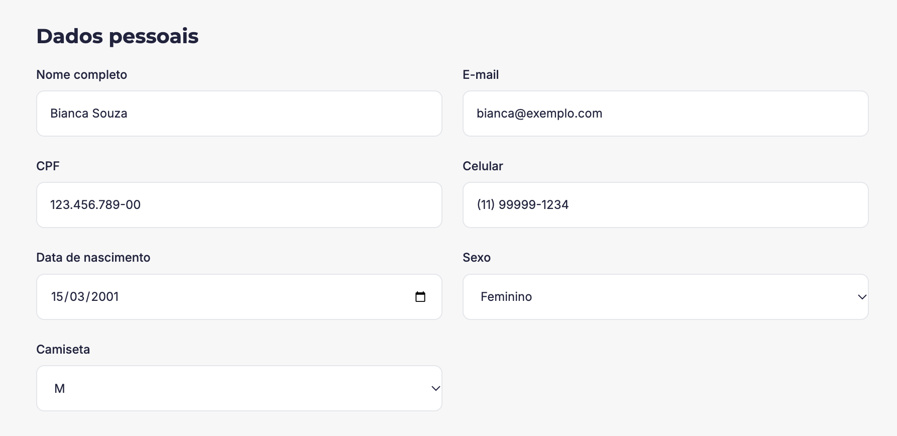
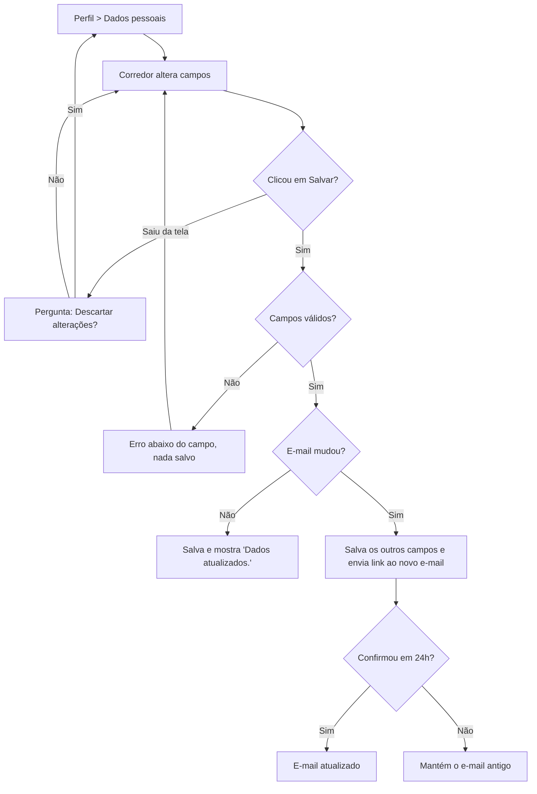

---
dependencies:["00 [Perfil] Dados pessoais.teste.md", "00 [Perfil] Dados pessoais.grillme.md"]
---

# 🚀 [Perfil] Dados pessoais

**Eu, como** corredor com conta no CorreAki (ex.: [Bianca](../persona-bianca.md) ou [Valdir](../persona-valdir.md)),  
**quero** consultar e atualizar meus dados pessoais no perfil,  
**para que** minhas próximas inscrições já venham preenchidas e corretas, sem digitar tudo de novo a cada prova.

> **Onda**: 7 ([ondas.md](../ondas.md)) · **Grupo**: Perfil · **Confiança**: 🟩 Alta · **E** 2 · **$** 1 · **S2** 1
> **Arquivos**: [grill-me](00%20%5BPerfil%5D%20Dados%20pessoais.grillme.md) · [testes](00%20%5BPerfil%5D%20Dados%20pessoais.teste.md)

---

### 1. 💼 Contexto de Negócio (O Porquê)
O passo 2 da inscrição pede nome, CPF, data de nascimento, sexo e camiseta. Sem um perfil confiável, o corredor digita esses dados a cada prova, o que aumenta o esforço e o abandono do checkout (métricas **CES da inscrição** e **taxa de abandono** em [metricas-heart-correaki.md](../metricas-heart-correaki.md)). Para quem corre com frequência, como o Valdir, isso pesa na meta de **recorrência de 50% em 12 meses**.

A tela também concentra dados pessoais sensíveis, então precisa seguir a LGPD e deixar claro o que pode e o que não pode ser alterado.

### 🎨 Protótipo (Figma)

Sem Figma: a referência é o protótipo no Lovable ([corre-aki.lovable.app](https://corre-aki.lovable.app/), rota `/perfil`) e o print enviado pela PM.

*1. Seção "Dados pessoais" do perfil preenchida com a usuária de exemplo: nome completo, e-mail, CPF, celular, data de nascimento, sexo (seleção) e camiseta (seleção). No protótipo, todos os campos aparecem editáveis e não há botão de salvar visível. Esta história ajusta esses pontos (RN02, RN03 e RN11).*

---

### 2. 🖥️ Fluxo de Funcionamento (O Quê)
*   **Acesso**: menu "Perfil" > seção "Dados pessoais".
*   **Perfil**: o corredor logado, e só para os próprios dados. Não existe outro perfil de usuário nesta história.
*   **Comportamento passo a passo**:
    *   *Passo 1*: O corredor abre o Perfil e vê a seção "Dados pessoais" com os dados do cadastro.
    *   *Passo 2*: Altera um ou mais campos. O botão "Salvar alterações" fica ativo.
    *   *Passo 3*: Clica em "Salvar alterações". O sistema valida os campos.
    *   *Passo 4a*: Tudo válido: salva e exibe *"Dados atualizados."*
    *   *Passo 4b*: E-mail alterado: salva os outros campos, envia um link de confirmação para o novo e-mail e exibe *"Enviamos um link para [novo e-mail]. Seu e-mail só muda depois da confirmação."*
    *   *Passo 4c*: Algum campo inválido: nada é salvo, e o campo mostra a mensagem de erro logo abaixo.

---

### 3. 📊 Campos e Dados Envolvidos (Os Dados)
*   **Nome completo** (texto, obrigatório, nome e sobrenome, máx. 100 caracteres).
*   **E-mail** (texto, obrigatório, formato de e-mail; a troca exige confirmação).
*   **CPF** (somente leitura, com máscara 000.000.000-00).
*   **Celular** (texto, obrigatório, máscara (00) 00000-0000).
*   **Data de nascimento** (data, opcional no perfil).
*   **Sexo** (seleção única, opcional no perfil): Feminino · Masculino · Prefiro não informar.
*   **Camiseta** (seleção única, opcional no perfil): PP · P · M · G · GG · XGG.

---

### 4. 🛑 Regras de Negócio e Restrições (Os Limites)
*   **RN01**: só o corredor logado vê e altera os próprios dados. A regra também vale no servidor: não é possível ler ou alterar os dados de outra conta.
*   **RN02**: o CPF é somente leitura. Ele identifica o titular das inscrições e não pode ser alterado pela tela.
*   **RN03**: a troca de e-mail só vale depois que o corredor clica no link enviado ao novo endereço. O link vale por 24 horas. Até a confirmação, login e avisos continuam no e-mail antigo, que também recebe um aviso da solicitação de troca.
*   **RN04**: o novo e-mail não pode estar em uso por outra conta.
*   **RN05**: nome completo é obrigatório, com pelo menos duas palavras e até 100 caracteres.
*   **RN06**: celular é obrigatório, com DDD válido e 11 dígitos começando com 9.
*   **RN07**: a data de nascimento, quando preenchida, precisa indicar 18 anos ou mais, não pode ser futura e não pode passar de 100 anos atrás.
*   **RN08**: data de nascimento, sexo e camiseta são opcionais no perfil, mas obrigatórios no passo 2 da inscrição. O que estiver no perfil pré-preenche esse passo.
*   **RN09**: alterações no perfil valem só para novas inscrições. Inscrições já feitas mantêm os dados do momento da compra.
*   **RN10**: o botão "Salvar alterações" só fica ativo quando algum campo mudou. Ao sair da tela com alterações não salvas, o sistema pergunta *"Descartar alterações?"* (Descartar · Continuar editando).
*   **RN11**: se algum campo for inválido, nada é salvo (o salvamento é tudo ou nada, exceto o e-mail, que segue a RN03).
*   **RN12**: esta história não gera notificação de alteração de cadastro. Isso é o cartão "Alertas de alteração de cadastro" da Onda 10.
*   **RN13**: LGPD e acessibilidade: dados pessoais não aparecem em logs; todo campo tem rótulo lido por leitor de tela; erros são anunciados e ficam ligados ao campo (WCAG 2.1 AA, conforme o [DoD](../dor-dod.md)).
*   **RN14**: se os dados foram salvos em outro acesso (ex.: no celular) depois que a tela foi aberta, o salvamento é recusado e o corredor é avisado para recarregar, sem sobrescrever o que já foi salvo.
*   **RN15**: o corredor pode pedir no máximo 5 trocas de e-mail por hora. O link de confirmação funciona sem login, inclusive em outro aparelho.

---

### 5. 🚨 Cenários de Erro e Exceções
*   **Nome incompleto**: *"Informe nome e sobrenome."*
*   **E-mail inválido**: *"Informe um e-mail válido."*
*   **E-mail em uso**: *"Este e-mail não pode ser usado. Tente outro."* (sem revelar que existe outra conta com ele).
*   **Celular inválido**: *"Informe um celular válido com DDD."*
*   **Menor de 18 anos**: *"É preciso ter 18 anos ou mais para usar o CorreAki."*
*   **Data futura ou acima de 100 anos**: *"Informe uma data de nascimento válida."*
*   **Link de confirmação expirado**: *"Este link expirou. Peça a troca de e-mail de novo no seu perfil."*
*   **Dados alterados em outro acesso**: *"Seus dados foram alterados em outro acesso. Recarregue a página."*
*   **Limite de trocas de e-mail**: *"Você fez muitos pedidos de troca de e-mail. Tente de novo mais tarde."*
*   **Falha de conexão ao salvar**: *"Não foi possível salvar agora. Tente novamente."* Os dados digitados continuam na tela.

---

### 🧪 6. Critérios de Aceite (BDD - Gherkin)

#### Cenário 1: Atualizar dados com sucesso
*   **Dado** que a corredora está logada em Perfil > Dados pessoais.
*   **Quando** ela troca o celular para "(11) 98888-7777" e a camiseta para "G" e clica em "Salvar alterações".
*   **Então** o sistema salva, exibe *"Dados atualizados."* e o botão "Salvar alterações" volta a ficar inativo.

#### Cenário 2: Trocar o e-mail
*   **Dado** que o corredor está em Dados pessoais.
*   **Quando** ele troca o e-mail para um endereço livre e salva.
*   **Então** o sistema envia o link ao novo e-mail, avisa o e-mail antigo e exibe *"Enviamos um link para [novo e-mail]. Seu e-mail só muda depois da confirmação."*
*   **E** o e-mail só muda depois que ele clica no link, em até 24 horas.

#### Cenário 3: Campo inválido bloqueia o salvamento
*   **Dado** que o corredor está em Dados pessoais.
*   **Quando** ele informa uma data de nascimento de quem tem 16 anos e clica em "Salvar alterações".
*   **Então** nada é salvo, e o campo mostra *"É preciso ter 18 anos ou mais para usar o CorreAki."*

#### Cenário 4: CPF não pode ser alterado
*   **Dado** que o corredor está em Dados pessoais.
*   **Quando** ele tenta editar o CPF.
*   **Então** o campo está bloqueado, e um pedido direto ao servidor para mudar o CPF é recusado.

#### Cenário 5: Perfil incompleto pré-preenche a inscrição
*   **Dado** que o perfil tem a camiseta "M" e não tem data de nascimento.
*   **Quando** o corredor chega ao passo 2 da inscrição.
*   **Então** a camiseta vem como "M", e a data de nascimento aparece vazia e obrigatória.

#### Cenário 6: Alteração não muda inscrição já feita
*   **Dado** que a corredora tem uma inscrição com camiseta "M".
*   **Quando** ela muda a camiseta do perfil para "G".
*   **Então** a inscrição existente continua com "M", e só as próximas inscrições vêm com "G".

#### Cenário 7: Sair sem salvar
*   **Dado** que o corredor alterou um campo e não salvou.
*   **Quando** ele tenta sair da tela.
*   **Então** o sistema pergunta *"Descartar alterações?"*, e só descarta se ele escolher "Descartar".

#### Cenário 8: Edição em dois aparelhos
*   **Dado** que o corredor abriu Dados pessoais no computador e depois salvou uma alteração pelo celular.
*   **Quando** ele tenta salvar pelo computador.
*   **Então** o sistema recusa e exibe *"Seus dados foram alterados em outro acesso. Recarregue a página."*, mantendo o que foi salvo no celular.

---

## 📎 Arquivos que acompanham a história
- [00 [Perfil] Dados pessoais.grillme.md](00%20%5BPerfil%5D%20Dados%20pessoais.grillme.md): decisões, rodada do grill-me e pendências.
- [00 [Perfil] Dados pessoais.spec.md](00%20%5BPerfil%5D%20Dados%20pessoais.spec.md): especificação técnica.
- [00 [Perfil] Dados pessoais.teste.md](00%20%5BPerfil%5D%20Dados%20pessoais.teste.md): matriz de rastreabilidade e casos de teste.
- [imagens/](imagens/): print do protótipo.
