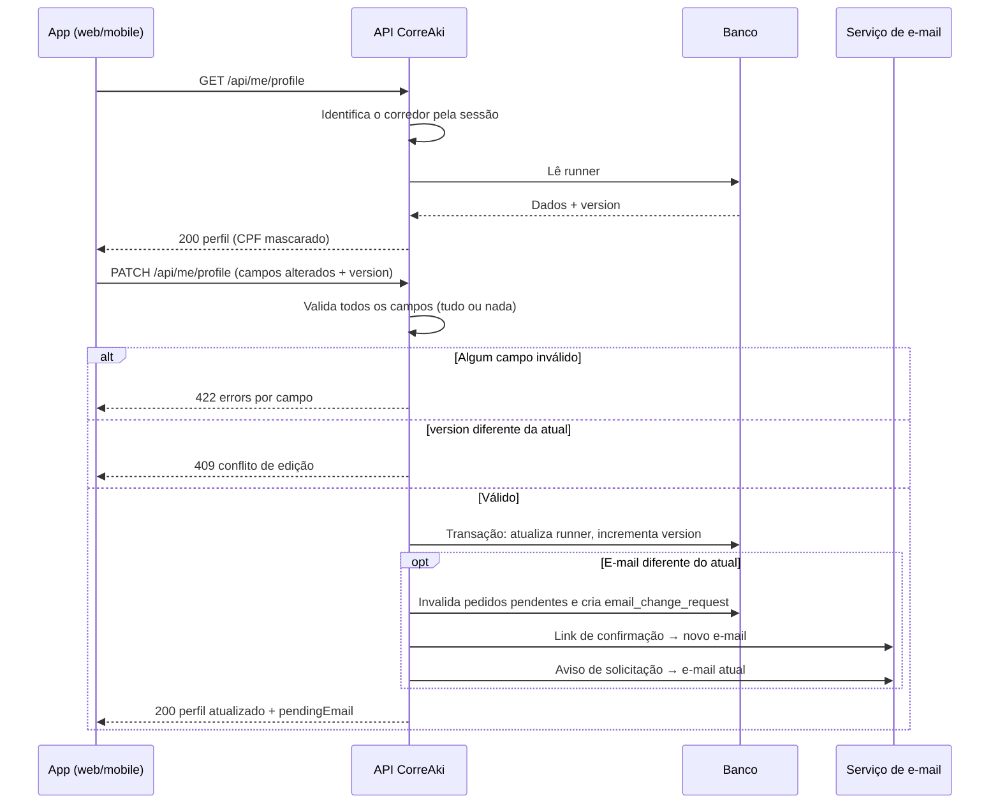
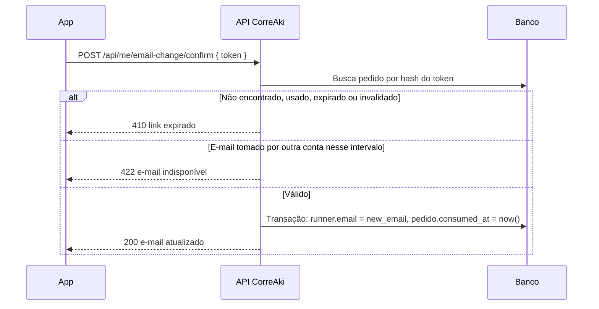

# 📋 Spec · [Perfil] Dados pessoais

**Versão:** 1.0.0  
**Domínio:** Perfil do corredor  
**Status:** Aprovada  
**História:** [00 [Perfil] Dados pessoais.md](00%20%5BPerfil%5D%20Dados%20pessoais.md) · **Grill-me:** [grillme](00%20%5BPerfil%5D%20Dados%20pessoais.grillme.md) · **Testes:** [teste](00%20%5BPerfil%5D%20Dados%20pessoais.teste.md)

> Spec **agnóstica de stack**: descreve contratos HTTP/JSON, modelo de dados e regras sem amarrar a linguagem, framework ou banco. Os nomes de tabela e coluna usam snake_case e servem de referência para qualquer banco relacional.

---

## 1. Visão Geral

Permite que o corredor autenticado consulte e atualize os próprios dados pessoais, que depois pré-preenchem o passo 2 da inscrição.

Problemas de engenharia que a feature resolve:
- **Fonte única** dos dados do corredor, lida pelo checkout.
- **Imutabilidade do CPF**, que identifica o titular das inscrições.
- **Troca de e-mail segura**, com confirmação por link de uso único, sem trocar a credencial de login antes da confirmação.
- **Retrato (snapshot) dos dados na inscrição**, para que mudanças no perfil não alterem inscrições já pagas.

Fora do escopo: notificação de alteração de cadastro (Onda 10), endereço, objetivos, acessibilidade PCD e exclusão de conta.

---

## 2. Arquitetura e Fluxo de Dados

O corredor é identificado **somente pela sessão** (token ou cookie). Nenhum endpoint recebe id de usuário na URL ou no corpo: todos operam sobre `/me` (RN01).

### 2.1. Atualizar dados



### 2.2. Confirmar troca de e-mail



> O envio de e-mail é feito **depois do commit** da transação (ou por fila). Uma falha no envio não desfaz a alteração; o corredor pode pedir de novo.

---

## 3. Definição de Endpoints e Contratos

Todos os endpoints exigem sessão válida (sem sessão: **401**). Erros seguem o envelope:

```json
{
  "error": { "code": "VALIDATION_ERROR", "message": "Mensagem em pt-BR" },
  "fields": { "fullName": "Informe nome e sobrenome." }
}
```

`fields` só aparece em erros de validação; a tela exibe cada mensagem abaixo do campo correspondente.

### 3.1. `[GET] /api/me/profile`
Retorna os dados pessoais do corredor logado. Também é usado pelo passo 2 da inscrição para pré-preencher o formulário (RN08).

*Retorno (200)*:
```json
{
  "fullName": "Bianca Souza",
  "email": "bianca@exemplo.com",
  "pendingEmail": null,
  "cpf": "123.456.789-00",
  "phone": "11999991234",
  "birthDate": "2001-03-15",
  "sex": "FEMALE",
  "shirtSize": "M",
  "version": 7
}
```
- `cpf`: sempre formatado e somente leitura.
- `phone`: só dígitos; a máscara é aplicada na tela.
- `birthDate`, `sex`, `shirtSize`: podem ser `null`.
- `pendingEmail`: e-mail aguardando confirmação, ou `null`.
- `version`: número usado no controle de edição concorrente.

### 3.2. `[PATCH] /api/me/profile`
Atualiza os campos enviados. Campos ausentes não mudam; `null` limpa um campo opcional.

*Request Body*:
```json
{
  "fullName": "Bianca Souza",
  "email": "bianca.nova@exemplo.com",
  "phone": "11988887777",
  "birthDate": "2001-03-15",
  "sex": "FEMALE",
  "shirtSize": "G",
  "version": 7
}
```

| Status | Quando | Corpo |
|---|---|---|
| **200** | Salvo | Perfil atualizado (mesmo formato do GET), com `pendingEmail` preenchido se o e-mail mudou |
| **400** | Corpo contém `cpf` ou campo desconhecido | `code: "FIELD_NOT_ALLOWED"` |
| **409** | `version` diferente da atual | `code: "EDIT_CONFLICT"`, mensagem *"Seus dados foram alterados em outro acesso. Recarregue a página."* |
| **422** | Um ou mais campos inválidos, ou e-mail indisponível | `code: "VALIDATION_ERROR"` com `fields` |
| **429** | Limite de pedidos de troca de e-mail atingido | `code: "RATE_LIMITED"` |

- Se o `email` enviado for igual ao atual, não gera pedido de troca.
- Se for igual ao `pendingEmail`, reenvia o link e reinicia o prazo de 24 h.

### 3.3. `[POST] /api/me/email-change/confirm`
Confirma a troca de e-mail a partir do link. A rota da tela (ex.: `/perfil/confirmar-email?token=...`) chama este endpoint.

> Exige sessão? **Não** (decisão da PM). O link pode ser aberto em outro aparelho; o token de uso único, com validade de 24 h, é a prova.

*Request Body*:
```json
{ "token": "string (opaco, 32+ bytes aleatórios em base64url)" }
```

| Status | Quando | Mensagem |
|---|---|---|
| **200** | E-mail trocado | *"E-mail atualizado."* |
| **410** | Token inexistente, usado, expirado ou invalidado | *"Este link expirou. Peça a troca de e-mail de novo no seu perfil."* |
| **422** | O novo e-mail passou a ser usado por outra conta | *"Este e-mail não pode ser usado. Tente outro."* |

---

## 4. Regras de Negócio Críticas (Specs)

| ID | Regra de Negócio | Detalhamento Técnico / Validação |
| :--- | :--- | :--- |
| **RN01** | **Só os próprios dados** | Endpoints usam `/me`, e o usuário vem da sessão. Não existe rota com id de usuário, então não há como apontar para outra conta. Sem sessão: 401. |
| **RN02** | **CPF imutável** | `cpf` não faz parte do contrato do PATCH: enviá-lo retorna 400 `FIELD_NOT_ALLOWED`. No banco, a coluna é `NOT NULL UNIQUE` e não há caminho de escrita fora do cadastro. Na tela, o campo é somente leitura. |
| **RN03** | **Troca de e-mail com confirmação** | Cria `email_change_request` com `token_hash` (SHA-256 do token; o token em claro só vai no link), `expires_at = now() + 24h`. `runner.email` não muda até a confirmação. Um pedido novo invalida os pendentes (`invalidated_at`). O e-mail atual recebe aviso. |
| **RN04** | **E-mail único** | Normalização: `trim` + minúsculas. Unicidade em `runner.email` (índice único) checada no PATCH e de novo na confirmação. A mensagem é genérica, sem revelar a outra conta. |
| **RN05** | **Nome completo** | `trim`, espaços repetidos viram um só; pelo menos 2 palavras; 2 a 100 caracteres; letras (com acentos), espaço, apóstrofo e hífen. |
| **RN06** | **Celular** | Só dígitos após limpar a máscara: 11 dígitos, DDD na lista de DDDs válidos da Anatel, terceiro dígito `9`. Regex de formato: `^[1-9]{2}9\d{8}$`. |
| **RN07** | **Data de nascimento** | Opcional. Formato ISO `YYYY-MM-DD`. A idade é calculada no fuso `America/Sao_Paulo`: idade ≥ 18; data ≤ hoje; data ≥ hoje − 100 anos. |
| **RN08** | **Opcionais no perfil, obrigatórios na inscrição** | `birth_date`, `sex` e `shirt_size` aceitam `NULL`. A inscrição lê o GET de perfil para pré-preencher e exige esses campos na validação dela. |
| **RN09** | **Inscrição guarda o retrato dos dados** | Ao criar uma inscrição, os dados do corredor são **copiados** para a inscrição (ver 5.3). O PATCH de perfil nunca atualiza inscrições. |
| **RN10** | **Salvar só com mudanças / aviso ao sair** | Regra de tela: compara o formulário com o último GET. Botão inativo sem diferença; ao sair com diferença, pede confirmação. |
| **RN11** | **Tudo ou nada** | Todas as validações rodam antes de qualquer escrita. Com qualquer erro, retorna 422 com todos os campos inválidos e nada é gravado. Gravação em uma única transação. |
| **RN12** | **Sem notificação** | O PATCH não cria registro de notificação. O cartão da Onda 10 poderá assinar um evento `runner.profile_updated`, que esta spec não exige publicar. |
| **RN13** | **LGPD e acessibilidade** | Logs registram só `runner_id`, campos alterados (nomes, sem valores) e o resultado. Nunca registrar nome, CPF, e-mail, celular, data de nascimento nem token. Tela: rótulo em todo campo, erro ligado ao campo (`aria-describedby`) e anunciado (`aria-live`), WCAG 2.1 AA. |
| **RN14** | **Edição concorrente** | Controle otimista por `version`: o PATCH só grava se a `version` enviada for igual à do banco; senão, 409. Evita que um aparelho sobrescreva sem querer o que outro salvou. |
| **RN15** | **Limite de pedidos de troca de e-mail** | No máximo 5 pedidos por corredor por hora; acima disso, 429. Evita spam para terceiros e tentativa de descobrir e-mails cadastrados. |

---

## 5. Esquema de Dados e Persistência

### 5.1. Tabela `runner` (colunas desta feature)
A tabela de corredor já nasce no cartão "Criação de usuário e senha" (Onda 1). Esta feature usa ou acrescenta:

| Coluna | Tipo | Nulo | Observação |
|---|---|:---:|---|
| `id` | UUID | não | PK |
| `full_name` | VARCHAR(100) | não | RN05 |
| `email` | VARCHAR(254) | não | Minúsculas; índice único (RN04) |
| `cpf` | CHAR(11) | não | Só dígitos; índice único; imutável (RN02) |
| `phone` | CHAR(11) | não | Só dígitos (RN06) |
| `birth_date` | DATE | sim | RN07 |
| `sex` | VARCHAR(20) | sim | `FEMALE`, `MALE`, `NOT_INFORMED` |
| `shirt_size` | VARCHAR(3) | sim | `PP`, `P`, `M`, `G`, `GG`, `XGG` |
| `version` | INTEGER | não | Default 1; +1 a cada atualização (RN14) |
| `created_at` / `updated_at` | TIMESTAMPTZ | não / sim | Auditoria |

### 5.2. Tabela nova `email_change_request`

```sql
-- up
CREATE TABLE email_change_request (
    id              UUID PRIMARY KEY,
    runner_id       UUID NOT NULL REFERENCES runner (id) ON DELETE CASCADE,
    new_email       VARCHAR(254) NOT NULL,
    token_hash      CHAR(64) NOT NULL UNIQUE,
    expires_at      TIMESTAMPTZ NOT NULL,
    consumed_at     TIMESTAMPTZ NULL,
    invalidated_at  TIMESTAMPTZ NULL,
    created_at      TIMESTAMPTZ NOT NULL DEFAULT now()
);

CREATE INDEX email_change_request_runner_idx
    ON email_change_request (runner_id, created_at DESC);

-- Adiciona o controle de versão à tabela runner, se ainda não existir
ALTER TABLE runner ADD COLUMN IF NOT EXISTS version INTEGER NOT NULL DEFAULT 1;

-- down
ALTER TABLE runner DROP COLUMN IF EXISTS version;
DROP TABLE IF EXISTS email_change_request;
```

- Pedido **válido** = `consumed_at IS NULL AND invalidated_at IS NULL AND expires_at > now()`.
- `pendingEmail` do GET = `new_email` do pedido válido mais recente.
- Pedidos com mais de 30 dias podem ser apagados por uma rotina de limpeza (LGPD: minimização).

### 5.3. Retrato na inscrição (dependência)
A tabela de inscrição (cartões de Checkout, Ondas 3 a 5) deve guardar uma cópia dos dados no momento da compra: `runner_full_name`, `runner_cpf`, `runner_birth_date`, `runner_sex`, `runner_shirt_size`. Esta spec só registra o requisito; a criação dessas colunas pertence à spec da inscrição.

---

## 6. Cenários de Homologação e Critérios de Aceite (BDD)

### Cenário 01: Atualizar dados com sucesso
*   **Dado** a corredora logada com `version = 7`
*   **Quando** envia PATCH com `phone = "11988887777"`, `shirtSize = "G"` e `version = 7`
*   **Então** a API responde 200 e a tela mostra *"Dados atualizados."*
*   **E** no banco `phone` e `shirt_size` mudaram e `version = 8`

### Cenário 02: Pedir e confirmar troca de e-mail
*   **Dado** um e-mail novo, sem uso por outra conta
*   **Quando** o corredor salva o perfil com esse e-mail
*   **Então** a API responde 200 com `pendingEmail` preenchido, envia o link ao novo e-mail e o aviso ao atual
*   **E** `runner.email` continua o antigo até `POST /api/me/email-change/confirm` com o token, que troca o e-mail e marca `consumed_at`

### Cenário 03: Link expirado ou substituído
*   **Dado** um token com mais de 24 h, ou de um pedido substituído por outro mais novo
*   **Quando** o corredor abre o link
*   **Então** a API responde 410 e a tela mostra *"Este link expirou. Peça a troca de e-mail de novo no seu perfil."*
*   **E** `runner.email` não muda

### Cenário 04: Campo inválido não grava nada
*   **Dado** um PATCH com celular válido e `birthDate` de quem tem 16 anos
*   **Quando** a API valida
*   **Então** responde 422 com `fields.birthDate = "É preciso ter 18 anos ou mais para usar o CorreAki."`
*   **E** nenhum campo é gravado e `version` não muda

### Cenário 05: Tentativa de alterar CPF
*   **Dado** um PATCH que contém `cpf`
*   **Quando** a API recebe
*   **Então** responde 400 `FIELD_NOT_ALLOWED`
*   **E** o CPF no banco não muda

### Cenário 06: E-mail já usado por outra conta
*   **Dado** um e-mail que pertence a outra conta
*   **Quando** o corredor tenta salvar com ele
*   **Então** a API responde 422 com *"Este e-mail não pode ser usado. Tente outro."*
*   **E** nenhum pedido de troca é criado

### Cenário 07: Edição em dois aparelhos
*   **Dado** que o corredor salvou pelo celular (`version` passou de 7 para 8)
*   **Quando** o computador envia PATCH com `version = 7`
*   **Então** a API responde 409 e a tela pede para recarregar
*   **E** os dados salvos pelo celular continuam intactos

### Cenário 08: Inscrição existente não muda
*   **Dado** uma inscrição criada com `runner_shirt_size = "M"`
*   **Quando** o corredor muda o perfil para `"G"`
*   **Então** a inscrição continua com `"M"`
*   **E** a próxima inscrição é pré-preenchida com `"G"`

### Cenário 09: Sem sessão
*   **Dado** um pedido sem sessão válida
*   **Quando** chama `GET` ou `PATCH /api/me/profile`
*   **Então** a API responde 401

---

## 7. Pendências técnicas

1. **Lista de DDDs válidos**: definir se fica fixa no código ou numa tabela de configuração.
2. **Serviço de e-mail transacional** ainda não escolhido. É uma dependência externa e entra no DoR ([dor-dod.md](../dor-dod.md)).
3. **Retrato na inscrição (5.3)** depende da spec do checkout.
